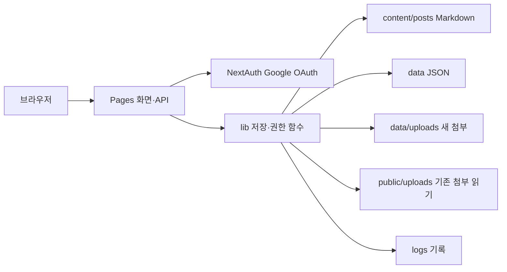

# 운영 및 개발 안내

## 구성과 실행

Pages Router의 `pages`가 화면과 API, `lib`가 파일 저장·권한·로깅을 담당한다.
`components`는 공용 UI, `contexts`는 테마·언어 상태,
`locales`와 `types/language.ts`는 한국어·영어 번역 계약을 가진다.

설치·실행 명령은 [README](../README.md)에서 확인한다. 현재 Node.js 조건은 `^22.13.0 || >=24.0.0`이다.
Google OAuth의 로컬 콜백은 `http://localhost:65002/api/auth/callback/google`이다.
운영에서는 실제 HTTPS 주소를 사용하고 `NEXTAUTH_URL`과 OAuth 리디렉션을 일치시킨다.

환경 설정은 `.env.example`을 참고하되 다음을 구분한다.

- `NEXTAUTH_SECRET`: 충분히 긴 무작위 비밀값. Git에 커밋하지 않는다.
- `GOOGLE_CLIENT_ID`, `GOOGLE_CLIENT_SECRET`: 환경별 OAuth 설정.
- `ADMIN_EMAILS`: 초기 관리자 설정. 이후 권한 관리와의 우선순위는 코드와 회귀 테스트를 확인한다.
- `WRITER_EMAILS`: 현재 권한 부여 경로가 아니다. 사용자 역할은 관리 화면과 저장된 사용자 정보로 관리한다.

새 첨부는 `data/uploads`에 저장하고 파일 API가 기존 `public/uploads`도 읽는다.
`/uploads/*` 요청은 Next.js의 `beforeFiles` rewrite로 파일 API를 통과시킨다.
운영 프록시가 `public/uploads`를 직접 정적 서빙한다면 이 보호를 우회하므로 별도로 확인한다.
실제 저장 파일은 Git 추적 대상에서 제외한다. 로컬 검증은 임시 저장 위치와 합성 사용자·게시글로 수행한다.
신규 업로드 소유자는 서버의 `data/upload-index.json`에 기록한다.
등록된 파일을 다른 작성자의 글에 새로 연결하는 요청은 거부하며,
관리자와 기존 참조 유지에는 예외를 둔다. 기존 미등록 파일의 소유자를 추측하거나 자동 등록하지 않는다.

`npm run attachments:inspect`는 현재 실행 디렉터리의 새·기존 첨부와 게시글 참조를 조사한다.
출력의 `untracked`는 소유권 미등록, `referenced`·`unreferenced`는 등록 파일의 참조 상태다.
미참조나 미등록이라는 사실만으로 삭제 권한을 주지 않는다. 이 명령은 정리·마이그레이션·파일 삭제를
수행하지 않는다. 소스 체크아웃의 개발 의존성으로 실행하며 standalone 배포 스크립트로 포함하지 않는다.
현재 Docker Compose 구성은 제공되지 않는다.

## 로컬 저장과 복구 경계

`lib/storage.ts`는 같은 로컬 파일시스템을 공유하는 프로세스의 동기 쓰기를
`data/.write-lock` 디렉터리 잠금으로 직렬화한다. 잠금 대기는 최대 5초이며
소유 PID·생성 시각을 `owner.json`에 기록한다. 파일은 같은 디렉터리의 임시 파일에 쓴 뒤
파일 fsync·rename으로 교체한다. 깨진 JSON은 빈 데이터베이스로 간주해 덮어쓰지 않는다.

프로세스가 비정상 종료하여 잠금이 남으면 자동으로 빼앗지 않는다.
작업자를 중지하고 실제 소유 프로세스·파일 상태·백업을 확인한 뒤 복구를 결정한다.
잠금 디렉터리나 데이터 파일을 검사 없이 삭제하지 않는다.
조회 기록·카운터 변경과 글 삭제 소유권 재검사는 같은 잠금 안에서 수행한다.
이는 파일 단위 교체와 로컬 동기 쓰기의 보장이다. 다중 파일 전체의 rollback,
전원 차단 시 디렉터리 메타데이터 내구성, 다중 호스트·NFS·백업 복구는 미검증 경계이며
[TODO](TODO.md)에서 관리한다.

빌드에서 변경 가능한 데이터·게시글·로그·첨부와 `.env`를 추적 자산에서 제외하므로,
standalone 실행 시 저장소 경로와 비밀값을 별도로 제공해야 한다.
`npm run build`는 Next.js 빌드 후 `scripts/check-standalone.cjs`를 실행한다.
이 검사는 생성된 `.next/standalone` 안의 runtime 데이터·첨부·로그·`.env`만 제거하고,
프로젝트 원본 소스 폴더가 산출물에 없음을 확인한다. 원본 저장소 데이터는 삭제하지 않는다.
산출물과 실행 검증은 [검증 기록](verification.md)을 확인한다.

## 권한 계약

공개 게시글과 첨부를 읽을 수 있다는 사실만으로 접근 통제 결함으로 판정하지 않는다.
서버 변경 API는 세션 식별자와 현재 저장된 역할을 기준으로 권한을 확인한다.
관리자는 모든 게시글을 관리하고, 작성자는 자신의 게시글을 관리하며,
독자·차단 사용자는 게시글 변경과 업로드를 할 수 없어야 한다.
권한 강등 후에도 오래된 세션의 역할로 변경 작업을 허용하지 않는 것이 회귀 검증 대상이다.
변경 요청은 `Origin`을 설정된 주소와 비교하고, Origin이 없으면
`Sec-Fetch-Site: cross-site`를 거부한다. 업로드에도 같은 검사가 적용된다.

파일명·날짜·첨부 메타데이터 등 클라이언트 입력은 서버에서 검증한다.
공개 응답에는 화면에서 필요한 필드만 포함한다. 소유권 검사는 공개 이메일 노출에 의존하지 않는다.
세부 결함·우선순위와 수정 상태는 [TODO](TODO.md), 확인 근거는 [검증 기록](verification.md)에 둔다.

## 자동 검사

`npm run lint`는 JavaScript 제어 흐름 권장 규칙과 React Hooks 호출·의존성 규칙을 적용한다.
TypeScript 이름·타입은 `npm run type-check`가 검사한다. 사용하지 않는 변수 규칙과
Next.js 전용 플러그인 검사가 활성화된 것으로 해석하지 않는다.
현재 실행 순서는 [README](../README.md), 실제 성공·실패·미실행 범위는
[검증 기록](verification.md)을 따른다.

## UI 개발 규칙

새 UI 텍스트는 `locales/ko.ts`, `locales/en.ts`에 중첩 키로 추가하고
`types/language.ts`의 `Translations`를 함께 갱신한다.
컴포넌트에서는 `useLanguage`의 `t`를 사용한다.
MUI 컴포넌트와 반응형 동작은 실제 화면에서 확인하며
[과거 MUI 보고서](history/MUI_VERIFICATION_REPORT.md)를 현재 증거로 재사용하지 않는다.

## 운영 반영 경계

이 저장소 변경이 운영 반영을 뜻하지 않는다. 운영 배포 버전과 프록시 설정을 확인한 뒤
헤더·리디렉션·OAuth·저장소 백업과 데이터 호환성을 검증해야 한다.
사용자가 명시 승인한 현재 변경과 후속 독립 개선은 빌드·검증 완료 후 커밋하고
GitHub `main`에 푸시할 수 있다. 성공 여부와 커밋·원격 상태는 확인한 뒤
[검증 기록](verification.md)에 남긴다. 실제 배포·계정 및 NAS 설정 변경·브라우저 승인 우회는
이번 작업 범위에 포함하지 않는다.
